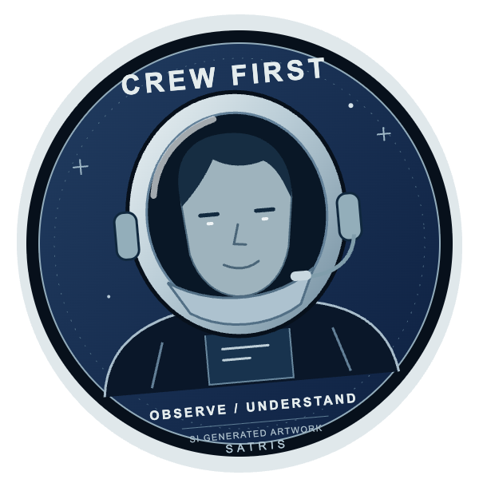
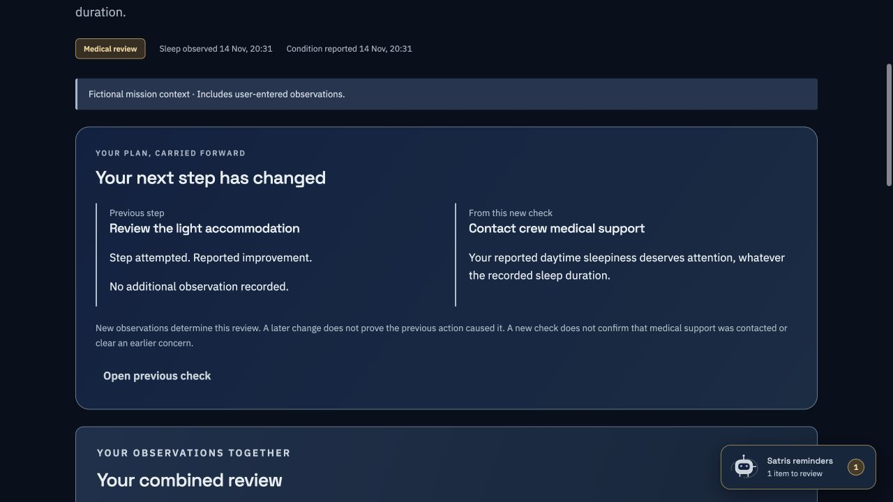
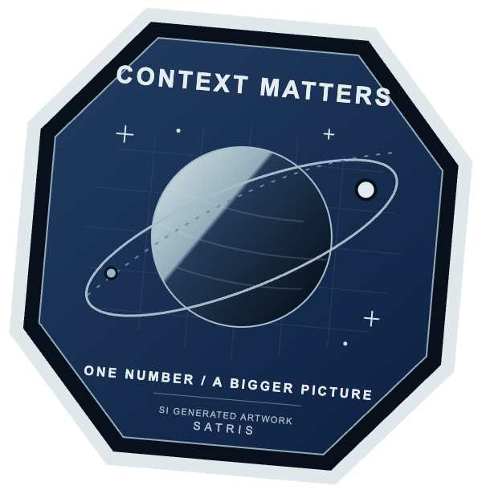
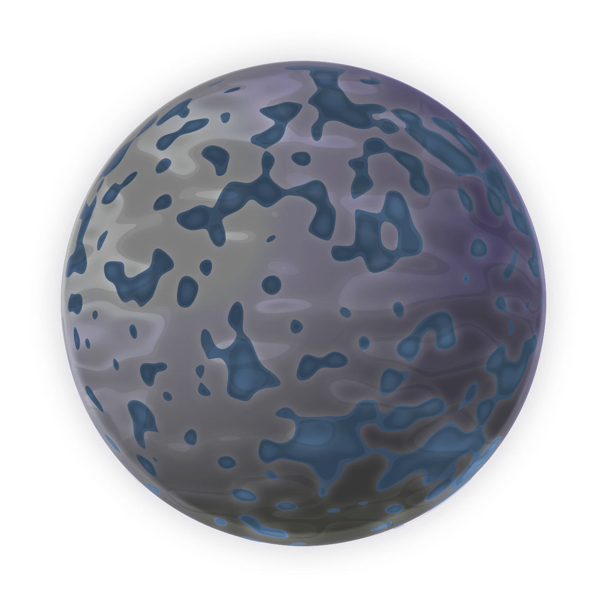

# Satris

### Your Next Health Step

[](https://drive.google.com/file/d/1W7qCCros51lsQRooAc0Zpz5bX4RLaoTC/view?usp=sharing)

**[Try Satris](https://satris.vercel.app/) · [Watch the demo with audio](https://drive.google.com/file/d/1W7qCCros51lsQRooAc0Zpz5bX4RLaoTC/view?usp=sharing)**

Satris helps a crew member turn routine sleep observations into an explained next step, then return to check what changed.

Developed by S.M.A.S.H. for the NASA Space Apps Challenge, **Create Health Monitoring Software for Astronauts on Space Missions**. The current release is **0.5.1**.

## The crew decision



A crew member records six hours of sleep. Was the sleep window too short? Was something disturbing their rest? Are they struggling to stay awake during activities?

Those situations call for different responses. Satris brings together time available for sleep, estimated time asleep, current sleepiness and noticed disruptions. It explains what those observations support, what remains uncertain and which next step fits the resources available.

The contribution is the connection between the check, the action and the return assessment. A recommendation stays attached to the observations behind it. On return, the crew member records whether the action was possible, enters fresh observations and sees whether the next step has changed.

## See it work

Open **Try an example** to compare three fictional cases. Each begins with six hours of reported sleep.

| Situation | What Satris helps the crew member do |
| --- | --- |
| Only six hours were available, against an entered eight hour plan | Identify the scheduling gap and review the sleep window with the appropriate support. The entered plan is not a medical threshold. |
| Eight hours were available, with reported light disturbance | Review the sleep accommodation, checking that any equipment is available and permitted. The report does not establish the cause of poor sleep. |
| Eight hours were available, with sleepiness affecting activities | Seek medical review through the available crew support route, including when ground communication is unavailable. |

Then try the return journey. Record an attempted accommodation change and enter a longer sleep duration alongside frequent unintended daytime sleep. Satris changes the next step to medical review. The new sleep duration does not erase the reported concern.



This fictional walkthrough demonstrates the implemented decision sequence. It does not show that an accommodation change caused improvement.

## How Satris works



**Observe.** Record sleep opportunity and estimated sleep in hours, how you feel now and anything you noticed disturbing sleep. Brief explanations distinguish the questions. Unknown values can stay unknown. Observation times, entry times and the origin of the information remain visible.

**Understand.** Explicit rules combine the observations and show their basis. Reported sleepiness affecting activities can take priority over the duration recorded. Missing information remains visible. Satris keeps clinical guidance, scheduling arithmetic and its own engineering choices distinct.

**Choose a feasible step.** Review the available sleep window, a reported environmental disturbance or the need for crew medical support. Space station, transit, rover and surface settings supply context. Confirmed equipment, permission and communication availability determine what is practical.

**Return and reassess.** Record whether the action was attempted, blocked or not tried, separately from feeling better, the same, worse or unsure. Add fresh observations. Satris preserves the original check and links the return assessment, updated guidance and review note.

**Keep the routine visible.** Today brings due checks and unresolved concerns into view. Descriptive charts show earlier compatible observations. Optional reminders and journey progress encourage returning without a health score or a penalty for missed checks. Reminder intervals are user choices, not prescribed examination schedules.

The interface works across phones, tablets and laptops. Examples and personal records have separate workspaces. A readable review note and structured JSON export retain the observations, timing, uncertainty and action history.

In app reminders work while Satris is open. Calendar reminders require importing the downloaded calendar file. Review notes are copied or downloaded for the user to share; Satris does not contact medical support automatically.

Our next step is clinical and human factors review with analog mission teams, followed by a comparison against the same observations and guidance presented as a readable sleep diary. We want to test whether people select a supported next step more accurately, with fewer consequential errors.

That evidence would guide device integration. A wearable or other measurement source should retain its method, units, time and quality alongside what the crew member reports. Further assessment workflows would explain what to measure, why it matters, how to obtain a usable reading and when to repeat it, using reviewed clinical guidance and the applicable mission procedure. These integrations and additional workflows are proposed work.

## Build and verify

Satris uses HTML, CSS and JavaScript, with Node.js for local development, tests and the static build. The assessment runs in the browser using explicit rules. No model service, API key or connected wearable is required.

With Node.js 20 or newer:

```sh
git clone https://github.com/Forgingalex/satris.git
cd satris
npm ci --ignore-scripts
npm start
```

Open the local address printed in the terminal. To run checks and create the deployment files:

```sh
npm test
npm run build
```

The build writes to `dist/`. GitHub Actions runs the repository checks. The public application is hosted on Vercel.

Release 0.5.1 passed **98 automated tests**. Recorded browser checks covered the assessment, blocked actions, return reviews, worsening concerns, exports, saved records and layouts across device sizes. These checks establish tested software behaviour. A comparative user study and clinical validation remain to be done.

Records stay in the current browser without an account, analytics or health data upload. Browser storage is not encrypted and can be cleared or evicted. Export records you need to keep.

## Sources and credits

NASA research and requirements inform the sleep, mission and interface reasoning. Satris uses published resources; the example health records are fictional.

| Resource | Use in Satris |
| --- | --- |
| [NASA Human Research Program risks](https://www.nasa.gov/hrp/risks/) | Spaceflight health and sleep risk context. |
| [NASA Medical Operations](https://www.nasa.gov/reference/6-0-medical-operations/) | Sleep scheduling and medical communication considerations. |
| [NASA Sleep Accommodation](https://www.nasa.gov/reference/7-0-habit-ability-functions-vol-2/) | Sleep environment and accommodation considerations. |
| [NASA Crew Interfaces](https://www.nasa.gov/reference/10-0-crew-interfaces-vol-2/) | Recognizable missing, unavailable and stale information. |
| [NASA Fatigue Management Services](https://ntrs.nasa.gov/api/citations/20200011570/downloads/20200011570.pdf) | Fatigue countermeasure context. |
| [Jones et al., Sleep, 2022](https://pubmed.ncbi.nlm.nih.gov/35023565/) | Research connecting sleep and neurobehavioral functioning in ISS astronauts. |
| [NHS daytime sleepiness guidance](https://www.nhs.uk/conditions/excessive-daytime-sleepiness-hypersomnia/) | Reasons to seek clinical review. Crew routing is a Satris adaptation. |
| [NHS shortness of breath guidance](https://www.nhs.uk/symptoms/shortness-of-breath/) and [AHA Adult Basic Life Support](https://cpr.heart.org/en/resuscitation-science/cpr-and-ecc-guidelines/adult-basic-life-support) | Limited urgent recognition and direction to applicable help. |

Source sections, versions and limitations are recorded in the application and in [the source definitions](src/sleep.js).

Artwork includes separate Satris crew and orbital stickers, plus a planet from [Kenney Planets](https://kenney.nl/assets/planets), released under [CC0](https://creativecommons.org/publicdomain/zero/1.0/), with the [original licence](docs/readme/Kenney-Planets-LICENSE.txt) included. Typography uses [Space Grotesk](https://github.com/floriankarsten/space-grotesk) and [IBM Plex Sans](https://github.com/IBM/plex), with their font licences included in the repository. The demo was recorded by the team and edited in CapCut.



Satris currently provides educational decision support for routine sleep checks. It has not been clinically validated or certified for flight and does not diagnose, prescribe treatment or clear anyone for a task. NASA resources inform the work; their use does not imply endorsement.

We welcome clinical review, a carefully defined input adapter or a comparative task study. [Open an issue](https://github.com/Forgingalex/satris/issues) with the workflow, evidence or test you would like to contribute.
